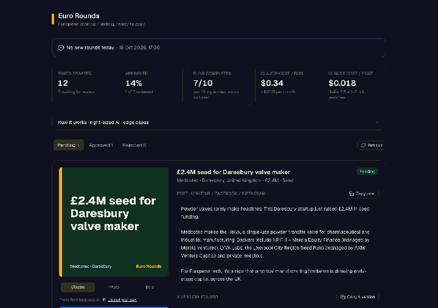
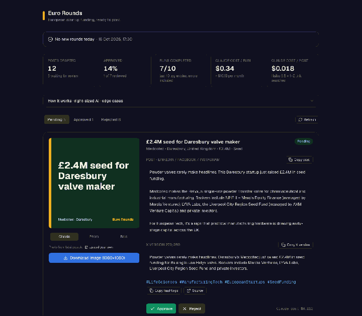

# Euro Rounds

**A daily European startup-funding post, researched, written, fact-checked and ready to publish, for about $0.36 a day.**

Euro Rounds is an n8n automation with a small review app. Every morning at 08:00 (Berlin) it finds the funding rounds announced in Europe in the last 48 hours, picks the three most interesting, and writes posts for LinkedIn / Facebook / Instagram plus an X version. Each post comes with a source link and a 1080×1080 image card: classic, the photo from the source article (credited), or your own uploaded press photo. You open the app, approve or reject, copy, post.

## Quick preview

<p align="center">
  
</p>

<p align="center">
  
</p>

🎥 **Demo video:** _link coming soon_

## Repository

| Path | What's inside |
|---|---|
| `n8n/` | Exports of the 3 live n8n workflows and the n8n Agent config, plus import steps |
| `app/`, `components/`, `lib/` | The Next.js review app (review queue, Classic / Photo / Bold cards, stats) |
| `app/api/` | Server routes that call the n8n API (the key never reaches the browser) |
| `demo/` | Demo script and `reset.sh` for recording takes |
| `docs/` | Lightweight dashboard and post-review GIF previews used above |

## The problem

Anyone who posts about European tech, whether a VC analyst, an ecosystem newsletter or a founder building an audience, has the same daily chore:

1. Scan Tech.eu, EU-Startups, Sifted, TechCrunch and national startup sites.
2. Remember who you already covered.
3. Check that the amount is actually stated, and the same across sources.
4. Write a post per platform, keep X under 280 characters, find the source link.
5. Make an image.

That's easily 45–60 minutes a day (my estimate), and the risky part is accuracy: one wrong amount in a public post hurts credibility. Euro Rounds automates steps 1–5 and keeps the human for the one decision that matters: **publish or not**.

## How it works

```
08:00 Schedule ─► Remember (30-day memory) ─► Research ─► Pick top 3 ─► Write + verify (×3) ─► Save as pending ─► Review app
                    data table              Sonnet 5.5     Haiku 5.5      Haiku 5.5               data table        approve / copy / card
                                            + web search                  + 1–2 searches
```

| n8n piece | Role |
|---|---|
| **Euro Rounds – Daily** (published) | Schedule + manual trigger, Anthropic node with web search, Code parsers, IF, Loop, Data tables |
| **Euro Rounds – API** (published) | 3 webhooks behind Header Auth: list posts, list runs, set status |
| **Euro Rounds – Error Handler** (published) | Error Trigger, set as the error workflow of Daily and API |
| **Euro Rounds Editor** (n8n Agent) | Answers questions about the data, rewrites posts on request (with approval), writes a weekly recap every Friday |
| Data tables | `euro_rounds_seen`, `euro_rounds_posts`, `euro_rounds_runs` |
| Web app (this repo, Next.js) | Review queue, copy buttons, 1080×1080 card download, run status, cost stats |

## Right-sized AI

The expensive model does only the step that needs judgment over the open web. Everything else runs on the cheap one.

| Step | Model | Why | Cost per run (list price, measured) |
|---|---|---|---|
| Research | Claude Sonnet 5.5 + up to 8 web searches | Judging sources, dates and amounts | ≈ $0.32 |
| Pick top 3 | Claude Haiku 5.5 | Ranking ~6 small objects | < $0.001 |
| Write + find source link | Claude Haiku 5.5 + 1–2 searches | Short copy from given facts | $0.013–0.024 per post |
| **Total** | | | **$0.36 measured on a real run (2 posts), about $11 / month** |

Every post stores its own `cost_usd`, and every run logs its total, both calculated from the token usage Claude returns. The app shows cost per run and per post. The Agent has a **$5/month budget guardrail** and a $0.25 per-session cap.

## Built to hold up: nothing fails silently

Four layers:

1. **In-flow error branches.** Every Claude call and every parser has an error output that writes the step name and message to `euro_rounds_runs`. If one post fails, the other posts still go through.
2. **Retries.** Research retries 3×, Pick and Write 2×, for transient API errors. (A real run during the build hit `Service unavailable`; it was caught and logged, and Research retries were added.)
3. **Error workflow.** `Euro Rounds – Error Handler` catches what the branches can't see: crashes, timeouts, the 180 s execution limit.
4. **Visible.** The app's status banner shows the latest run: OK with the trend note, *no new rounds*, or *error at step X*.

| Edge case | What happens |
|---|---|
| Company already covered | Skipped for 30 days |
| Source doesn't state an amount | Round dropped, never guessed |
| Sources, or the found article, disagree on the amount | ⚠️ *Check the amount* flag on the post |
| No new rounds today | Logged as `no_new_rounds`, no empty posts |
| Claude reply isn't valid JSON, or is cut off | Parser finds the JSON block or fails that step with the reply attached |
| Claude invents a source link | Rejected: only URLs that appeared in the web search results are kept |
| Missing investors or round type | Left out of the post; it never says "not disclosed" |
| Source site has no photo or blocks downloads | Classic card, or upload your own press photo |
| X version too long once hashtags are added | Hashtags are added only while it fits 280 characters |
| API called without the key | 403; invalid status changes get a 400 |
| Agent wants to change a post | Needs human approval in the chat |

## Built with a coding agent over the n8n MCP server

The whole n8n side was built by **Claude Code connected to n8n through the n8n MCP server**: data tables, the 3 workflows (written as n8n Workflow SDK code, then `validate_workflow` → `create_workflow_from_code`), the n8n Agent (`create_agent` → `mutate_agent` → `validate_agent` → `call_agent`), and the testing:

- **Pin-data tests** (`test_workflow`) for the logic without spending credits: duplicates, missing amounts, code fences, stray brackets, invented links, amount mismatches, the error path.
- **Real runs** (`execute_workflow`), then reading `get_workflow_execution` to debug. For example, the empty source links turned out to come from round-up pages, which led to the per-post link search.

## Demo (2 minutes)

1. **The app** (`npm run dev`): status banner → stats (cost per run and per post) → a pending post. Open **How it works** to show the pipeline and edge cases.
2. **A post:** card preview → *Download image* → *Copy post* / *Copy X version* (with the character counter) → source link → **Approve**.
3. **n8n:** open *Euro Rounds – Daily* and show the error branches, the retry settings and the Error Handler link. Click **Execute** (about 1 minute).
4. **The Agent:** in *Euro Rounds Editor*, ask *"What were the biggest rounds this week and what did the pipeline cost?"*, then *"Rewrite the Neonomics post shorter for LinkedIn"*. Show the approval prompt.
5. Back in the app, click **Refresh**. The new run and posts appear.

## Setup

1. n8n: import or keep the workflows in the **Euro Rounds** folder. Create a Header Auth credential **Euro Rounds App Key** (header `x-euro-rounds-key`) and attach it to the 3 API webhooks.
2. App:

```bash
cp .env.local.example .env.local   # N8N_WEBHOOK_BASE, EURO_ROUNDS_KEY, optional APP_PASSWORD
npm install
npm run dev
```

The key is only used in the app's server routes and never reaches the browser. Set `APP_PASSWORD` before deploying anywhere public.

## Limits and next steps

- Research quality depends on what the web search finds that day. Some rounds only appear in weekly round-ups, so their link comes from the per-post search.
- Costs are list-price estimates from reported token usage. This instance runs on n8n's built-in AI credits.
- Next: one-click posting through the LinkedIn / X APIs after approval, and a public weekly digest page.
